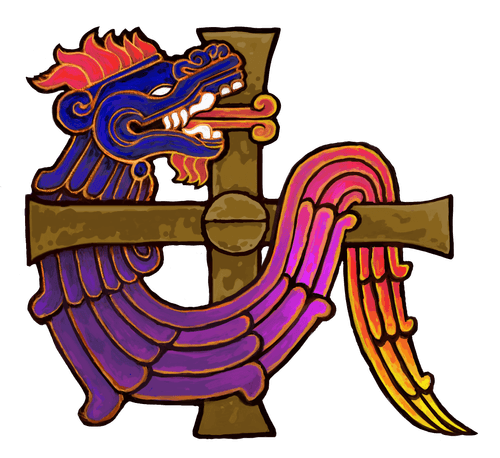

# Wisdom Duel · Mythical Beings



Build a team of three Creatures from the world of Mythical Beings. Draw Knowledge cards from a shared Market, rotate your Creatures and play Allies and Spells to reduce your opponent’s Power to zero.

## Objective and setup

Each player starts with 20 Power shared across their three Creatures. If both players reach zero or less simultaneously, the game is a draw. Five Knowledge cards start face up in the Market. Each Creature has an element, a passive ability and a Wisdom cycle. A Creature can hold one Knowledge card at a time.

## Playing a turn

In your **Knowledge Phase**, your Knowledge cards in play resolve at their current rotation, then rotate one step (90°). Some deal damage, provide Defense or grant Power. A card leaves play after its final rotation. Replacing a card also makes it leave play and can trigger a Creature’s passive ability.

In your **Action Phase**, you normally have two actions. **Draw from the Market** to add a card to your hand. **Rotate a Creature** to advance its Wisdom cycle. **Play a Knowledge card** from your hand on a Creature that meets its Wisdom requirement. If your hand exceeds five cards, discard down to five. **End Turn** lets you finish early.

## Example turn

Draw Lepidoptera and rotate Tarasca from 0 Wisdom to 2. Next turn, play Lepidoptera on Tarasca. The Air Ally requires 1 Wisdom, so Tarasca keeps its 2 Wisdom and Lepidoptera gives you 1 Power on play.

## Passives and signature interactions

- **Kappa** lets you play Water Knowledge cards without spending an action. **Dudugera** does the same for any Knowledge card played on it.
- **Lisovik** deals 1 damage when one of your Earth Knowledge cards leaves play. **Tarasca** deals 1 damage when your opponent plays an Earth Knowledge card.
- **Lafaic** can rotate another of your Knowledge cards when you play a Water card on it. **Zhar Ptitsa** lets damage from an Air Knowledge card on it bypass Defense.

## Strategy tips

- Plan around rotations. The next step on a card’s cycle shows how much damage, Defense or Power to expect.
- Time a replacement to trigger an ability when a Knowledge card leaves play.
- Hurricane can block an opposing Creature. Fire can discard several opposing Knowledge cards in one Knowledge Phase.
- Keep room in your hand for a Market draw. The hand limit is five.

## Learn the cards

The digital rules explain card types, actions, effect timing and the differences from the printed edition. [Digital rules](docs/rules/RULES.md) · [Card compendium](https://wisdomduel.mythicalbeings.io/how-to-play) · [Physical rulebook](public/RULEBOOK.pdf)

The reducer tests cover individual card interactions and edge cases. [Card and turn tests](tests/gameReducer)

## Play Locally

Prerequisites
- Node.js 22.13+ or 24.x (the repository pins 22.22.2 in `.nvmrc`)
- npm 10+

Install & Run
```bash
git clone https://github.com/palheiro1/mythical-beings-mvp.git
cd mythical-beings-mvp
nvm install
nvm use
npm install
npm run dev
```

Environment
Create a `.env.local` in the project root (see `.env.example`):
```
VITE_SUPABASE_URL=your_supabase_url
VITE_SUPABASE_ANON_KEY=your_supabase_anon_key
VITE_POLYGON_RPC_URL=your_polygon_rpc_url
VITE_POLYGON_CHAIN_ID=137
VITE_GEM_CONTRACT=0x5f790ffa0695967a2d711872ecb4c7553e24794d
VITE_CARDS_CONTRACT=0xcf55f528492768330c0750a6527c1dfb50e2a7c3
VITE_WISDOM_DUEL_ESCROW_ADDRESS=0x4DF3B86B9b1332779d8EAE7c276BcC1bDe2e19e9
VITE_ENABLE_PVP=false
```

Public builds default to the training-only preview. Keep both independent release
gates disabled until multiplayer sessions, GEM stakes, rankings, and competitive
rewards pass their launch gate:

- frontend: `VITE_ENABLE_PVP=false`
- Supabase Edge Functions: `WISDOM_DUEL_PVP_ENABLED=false`

Enabling the frontend flag alone must never enable multiplayer. A deliberate PvP
release requires both gates plus the server-authority and data-security gates in
`docs/tech/AUTHORITATIVE_GAME_PROTOCOL.md`.
The executable in-memory boundary and its remaining production limits are documented in
`docs/tech/AUTHORITATIVE_EXECUTOR.md`.

For competitive GEM matches, configure the matching Supabase Edge Function secrets listed in `.env.example`.

Observability is disabled by default. Error telemetry and Core Web Vitals are only
sent when both `VITE_OBSERVABILITY_ENABLED=true` and an HTTPS
`VITE_OBSERVABILITY_ENDPOINT` are configured. Payloads are sanitized and never
include game state, hands, deck, wallet, email, tokens, query strings, or session
identifiers. See `docs/tech/OBSERVABILITY_AND_PRIVACY.md` before enabling it.

Useful Commands
```bash
# Run development server
npm run dev

# Build for production
npm run build

# Run tests
npm test

# Check TypeScript without creating build files
npm run typecheck

# Check Supabase Edge Functions with the pinned Deno runtime
npm run typecheck:edge

# Run lint checks
npm run lint
```

## Project Structure (Short)

- src/game: core rules, state, actions, effects, passives
- src/components: UI components (Card, CreatureZone, Market, etc.)
- src/pages: app screens (Home, Lobby, GameScreen, etc.)
- tests: comprehensive unit/integration tests for rules, effects, passives

## Contributing

Contributions are welcome! Open an issue or PR with a clear description, and include tests for logic changes.

1) Fork the project
2) Create a feature branch: `git checkout -b feature/your-feature`
3) Commit: `git commit -m "Add your feature"`
4) Push: `git push origin feature/your-feature`
5) Open a Pull Request

## License

No license has been declared in this repository yet. Confirm the intended license with the project owner before redistributing the code or assets.

## Acknowledgements

- Inspired by global folklore and mythologies
- Thanks to contributors, playtesters, and artists

<p align="center"><em>May the wisest being win! 🏆</em></p>

## Wisdom Duel competitive v2

The competitive client has four entries: training, the free skill league, optional
GEM/card wagers, and standings/prizes. `/competition` opens the hub; `/league-admin`
requires a server-assigned organization role. League login needs a persistent
account; a verified Polygon wallet is required only for prizes and wagers.

The app and authoritative SDK use the exact vendored
`@mythicalb/wisdom-duel-engine@1.0.0` and `@mythicalb/sdk@0.4.0` packages. Tactical
modules re-export the shared engine. Browsers submit intentions with command IDs
and expected versions; private state, clocks, results, ratings and payments are
committed by the server. The client recovers pending commands across reconnects.

Set `VITE_WISDOM_DUEL_ESCROW_V2_ADDRESS` to the audited V2 deployment; the historical
escrow address is not interchangeable. Leave `VITE_ENABLE_PVP=false` until the full
integration and contract review gates pass. Existing match/replay/prize recovery
routes remain reachable when new entry is closed. Server admission, command and
recovery controls are independent. Season dates and GEM budget have no implicit
production defaults.

Canonical migrations, eight Edge APIs, pool funding instructions, Cron/Vault setup,
release manifests and recovery procedures are in the SDK's
`docs/wisdom-duel/OPERATIONS.md`. Its `scripts/verify-wisdom-release.mjs --pack`
builds and verifies the two app packages without publishing them. Keep this app's
coverage, lint, types, build, bundle, public-artifact and logging checks enabled;
the original critical coverage thresholds also measure the installed engine.

### Voice and video in invitation duels

Once both seats are filled, open **Voice & video** during team selection or in the arena. Choose the microphone and camera independently, then invite or accept. Both devices start off. Leaving the call, closing the duel, or finishing the match stops capture. The opponent's video can be hidden while listening.

The pilot uses the Play Hub Supabase project. Apply the SDK migration `wisdom_duel_invitation_calls`, deploy its `wisdom-duel-turn` Edge Function, and configure `CLOUDFLARE_TURN_KEY_ID` and `CLOUDFLARE_TURN_API_TOKEN` in that project's Edge Function secrets. These values come from a Cloudflare Realtime TURN key. The availability check hides the controls until both secrets are present. [Cloudflare TURN keys](https://developers.cloudflare.com/realtime/turn/generate-credentials/)

The server admits the two signed-in players in an invitation duel and removes eligibility if the room is ever listed publicly. At rollout, still-open invitations and newly created invitations qualify. Each acceptance belongs to one browser tab and one call. Signaling uses private Supabase Realtime broadcasts, media uses relay-only WebRTC, and the game records neither audio nor video.
